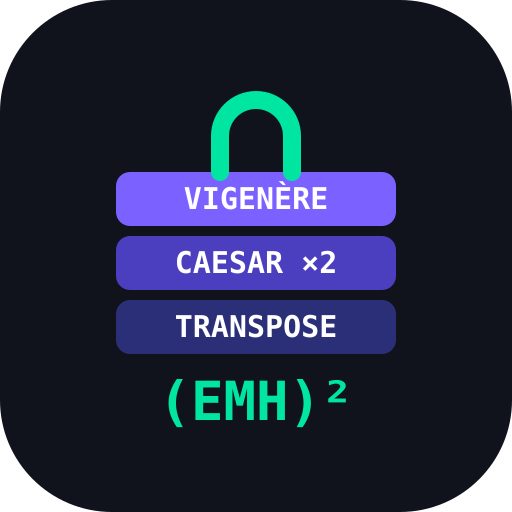
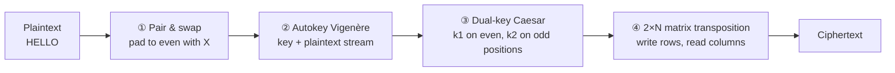

<div align="center">



# (EMH)² Cipher

**A multi-stage classical cipher that chains four transformations so no single classic attack breaks it alone.**


</div>

---

## Overview

Single classical ciphers each fall to a well-known attack: Caesar to brute force, Vigenère to Kasiski and frequency analysis, transposition to anagramming. For our **Cryptography** course project (3rd year, Cyber Security, Ar-Rasheed University) we designed **(EMH)²**, which layers them so each stage hides the weaknesses of the one before it.

## The pipeline



| Stage | What it does | Why |
|---|---|---|
| ① **Pair and swap** | Removes spaces, pads with `X` to even length, then swaps every pair (`HE LL OX → EH LL XO`) | Breaks up obvious letter order |
| ② **Autokey Vigenère** | `Cᵢ = (Pᵢ + Kᵢ) mod 26`, with the key extended by the plaintext itself | No repeating key, so Kasiski analysis doesn't apply |
| ③ **Dual-key Caesar** | Even positions shift by `k1` and odd positions by `k2` | Two alphabets flatten the frequency distribution |
| ④ **Matrix transposition** | Writes the text into 2 rows and reads it column by column | Spreads neighboring letters apart |

A fifth, **key-based block rearrangement** step (4-character blocks reordered by a key like `[3,1,2,4]`) is prototyped in [`step5.py`](step5.py).

## Usage

```bash
python encryption.py
```
```text
Enter the data to encrypt: ATTACK AT DAWN
Processed data after splitting and swapping: TAATKCTAADNW
Enter the key: SECRET
Encrypted data with AutoKey Vigenère: LECKOVMAAWXY
Enter the first Caesar key (k1): 5
Enter the second Caesar key (k2): 11
Final encrypted string after applying Caesar Cipher: QPHVTGRLFHCJ

Displaying by column (in one line):
QRPLHFVHTCGJ
```

```bash
python decryption.py
```
```text
Enter the encrypted data to decrypt (in column order): QRPLHFVHTCGJ
Enter the key: SECRET
Enter the first Caesar key (k1): 5
Enter the second Caesar key (k2): 11
...
Decrypted result: ATTACKATDAWN
```

Decryption runs the four stages in reverse and prints every intermediate result, which makes it useful for learning how each layer works.

## Files

| File | Purpose |
|---|---|
| [`encryption.py`](encryption.py) | Full 4-stage encryption |
| [`decryption.py`](decryption.py) | Full 4-stage decryption |
| [`step5.py`](step5.py) | Key-based block rearrangement (prototype) |
| [`docs/presentation.pptx`](docs/presentation.pptx) | Project presentation: algorithm, example, security analysis |

## Limitations (honest security notes)

This is a **classical-cipher learning project, not real-world cryptography.** Use AES or ChaCha20 for real data.

- Only `A–Z` is supported. Digits and punctuation are not handled, and spaces are dropped.
- Every stage is linear over ℤ₂₆, so a known-plaintext attack can recover the keys.
- `step5.py` has no matching decryption and isn't wired into the main pipeline yet.

### Fixed later
- **Odd-length messages decrypted with the wrong last letter.** The padding was a lowercase `x` added after upper-casing, so `HELLO` decrypted to `HELLOD`. It now pads with `X` (see the commit history).

## What I learned

- How Caesar, Vigenère, autokey and transposition ciphers work, and how each one is broken.
- Why layering ciphers raises the cost of an attack, and why it still doesn't make a cipher secure.
- Writing the inverse of every step and testing round-trips.

## Author

**Humam Al-Dhubhani**, Cyber Security, Ar-Rasheed University · [GitHub](https://github.com/humamaldhubhani)

<sub>Released under the [MIT License](LICENSE).</sub>
